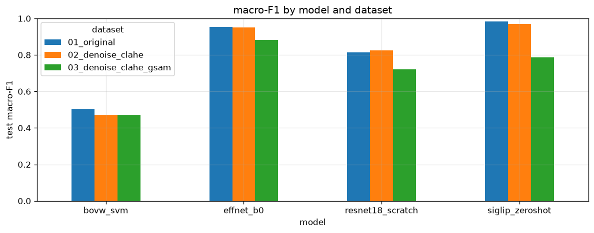
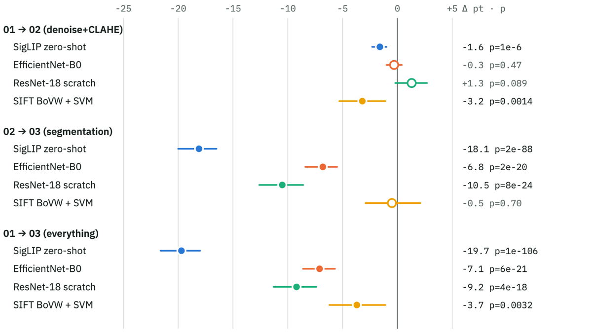
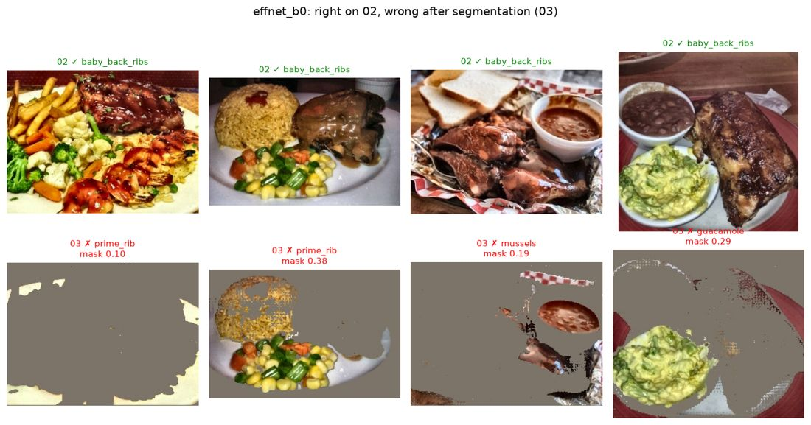
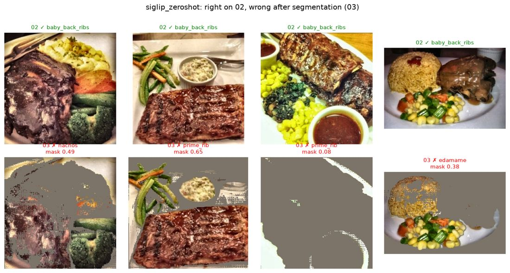
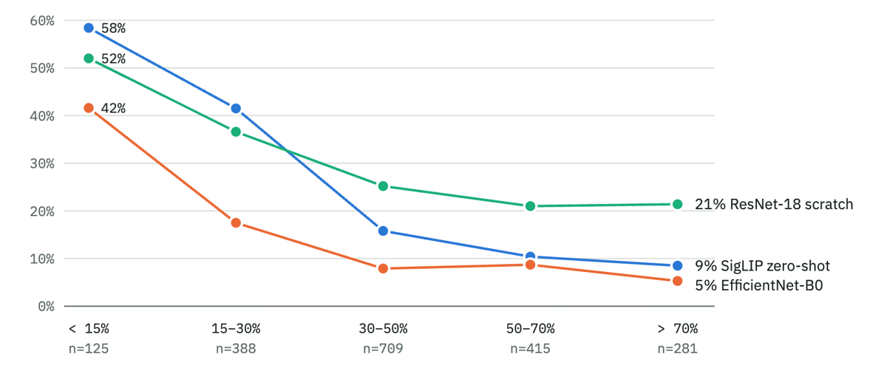
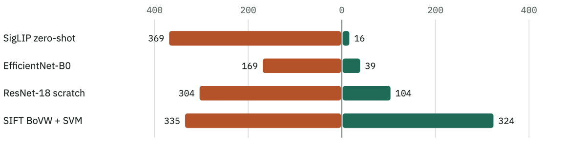
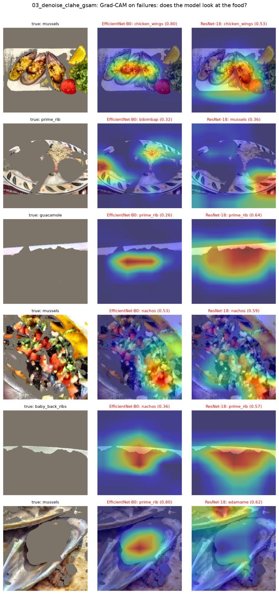
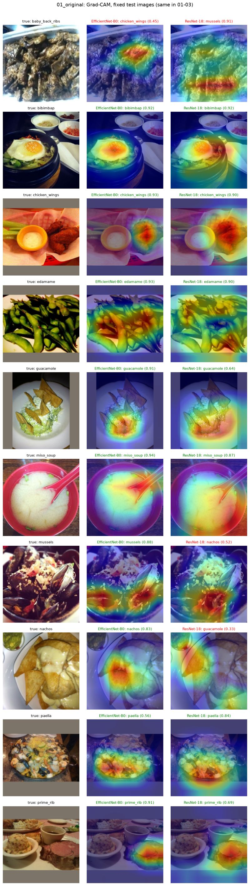
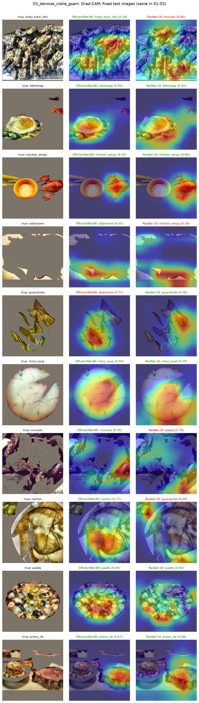
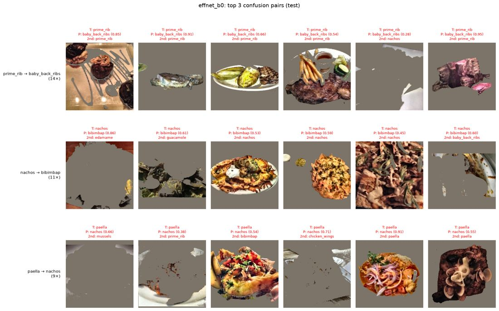

# Model exploration results: 4 models × datasets 01 / 02 / 03

Run on 2026-11-12/13, Mac M4 (MPS), `model_exploration/explore_models.ipynb`, `RUN_MODE = "full"`, one seed (42).
Each model's config was chosen on val macro-F1, and test was scored once. Test = 1,920 images (192 × 10 classes), the same in every dataset.
Raw tables: `model_exploration/reported_results/`.

## Test macro-F1

| model | 01 original | 02 denoise+CLAHE | 03 + Grounded-SAM |
|---|---|---|---|
| SigLIP base, zero-shot | 0.984 | 0.969 | 0.787 |
| EfficientNet-B0, transfer | 0.953 | 0.950 | 0.881 |
| ResNet-18, from scratch | 0.814 | 0.826 | 0.721 |
| Dense SIFT BoVW + χ² SVM | 0.506 | 0.473 | 0.469 |

Chosen configs:
- **SigLIP:** prompt `classname` on 01, `ensemble` on 02 and 03.
- **EfficientNet-B0:** unfreeze `top` on 01 and 02, `all` on 03.
- **ResNet-18:** base 64 with dropout 0.3 on 01 and 02, dropout 0 on 03.
- **BoVW + SVM:** K = 512 on every dataset, with C = 10, 1 and 100 on 01, 02 and 03.

## Paired tests (same test images)

Δ = B − A in macro-F1 points. The 95% CI comes from a bootstrap with 1,000 resamples. If the CI contains 0, the gap is not evidence.

| model | 01 → 02 | 02 → 03 (segmentation) | 01 → 03 |
|---|---|---|---|
| SigLIP | −1.6 [−2.3, −1.0], p = 1e-6 | **−18.1 [−20.0, −16.5]**, p = 2e-88 | −19.7 [−21.6, −18.0] |
| EfficientNet-B0 | −0.3 [−1.0, +0.4], p = 0.47 | **−6.8 [−8.4, −5.5]**, p = 2e-20 | −7.1 [−8.6, −5.7] |
| ResNet-18 | +1.3 [−0.2, +2.7], p = 0.089 | **−10.5 [−12.6, −8.6]**, p = 8e-24 | −9.2 [−11.3, −7.4] |
| BoVW + SVM | −3.2 [−5.3, −1.1], p = 0.0014 | −0.5 [−2.9, +2.1], p = 0.70 | −3.7 [−6.2, −1.1] |

With this mask setup, segmentation hurts 3 of the 4 models. Their drops are much larger than the ~±4.5 pt seed noise seen in the 25-Oct trial.

*A filled dot means the CI excludes 0. A hollow dot means it does not.*

## Why segmentation hurts

- **The mask removes the dark main dish.** These classes were chosen for being dark, and Grounded-SAM often turns the darkest region (ribs, prime rib, mussels) into grey background. It keeps the brighter side dishes. The failure galleries show ribs removed and corn, rice and potato salad kept, which leads to predictions such as prime_rib, mussels or guacamole.

  

  

  *Top row: dataset 02 (right). Bottom row: dataset 03 (wrong), with the mask area. Not every failure is food removal. In the second SigLIP example the ribs are kept (mask 0.65) and SigLIP still says prime_rib, so the grey background itself also confuses a model trained on whole photos.*
- **Error rises as the mask gets smaller.**

  | mask area / image | n | SigLIP | EfficientNet-B0 | ResNet-18 |
  |---|---|---|---|---|
  | < 15% | 125 | 58% | 42% | 52% |
  | 15–30% | 388 | 42% | 18% | 37% |
  | 30–50% | 709 | 16% | 8% | 25% |
  | 50–70% | 415 | 10% | 9% | 21% |
  | > 70% | 281 | 9% | 5% | 21% |

  Over all models, the images that segmentation made wrong have a median mask area of 0.30. The images it made right have 0.39.

  
- **Fallbacks are not the cause.** The test fallback rate is 0.6%. The harmful masks are ones that succeeded, but on the wrong region.
- **Pretrained models lose the most.** Counts are test images right on 02 but wrong on 03, against wrong on 02 but right on 03:

  | model | hurt | helped |
  |---|---|---|
  | SigLIP | 369 | 16 |
  | EfficientNet-B0 | 169 | 39 |
  | ResNet-18 | 304 | 104 |
  | BoVW + SVM | 335 | 324 |

  

  *Left (orange): right on 02, wrong on 03. Right (green): wrong on 02, right on 03.*

  BoVW uses local texture, so grey fill mostly just removes descriptors. This matches the 25-Oct trial: masking hurt the pretrained model.
- **Grad-CAM agrees.** On failures where the mask left only a plate rim or a grey hole, both CNNs focus on the rim or the hole. On the fixed 10-image set, edamame and guacamole lose the food after masking and flip to wrong. Bibimbap, chicken_wings, miso_soup and prime_rib keep the food and stay right. Grad-CAM shows where a model looks, not why it decides, so it supports the numbers above and does not replace them.

  

  *Dataset 03 failures. Columns: input, EfficientNet-B0, ResNet-18. Red marks the regions that drove the prediction.*

  | 01_original | 03_denoise_clahe_gsam |
  |---|---|
  |  |  |

  *The same 10 test images, one per class, before and after segmentation.*
- **Most frequent confusions** for EfficientNet-B0 on 03: prime_rib → baby_back_ribs (14), nachos → bibimbap (11), paella → nachos (9).

  

## Caveats

- **SigLIP may be inflated.** It was pre-trained on web-scale data that may include Food-101 images, so its 0.98 on 01 is likely an upper bound.
- **One seed.** The CI covers test-set sampling, not training randomness, so treat gaps of 1–3 pt as unconfirmed.
- **References are unchecked.** They are in `doc/references/model_exploration.md`, still marked ⚠️ until checked against the papers.

## Suggested next step

Run dataset 04 (DINO crop, no mask) through the same notebook. Comparing 02 → 04 → 03 shows how much of the drop comes from cropping and how much from SAM's mask. The evidence above points at the mask.
